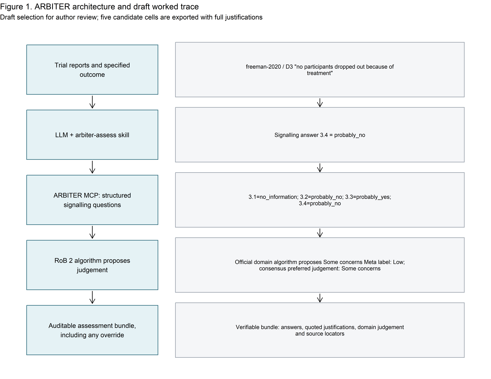
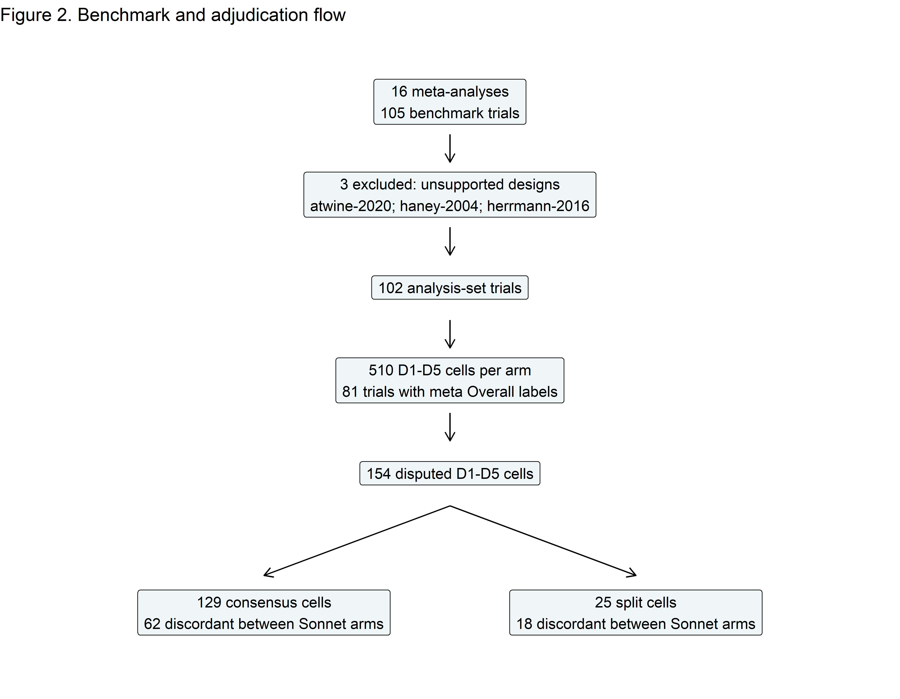
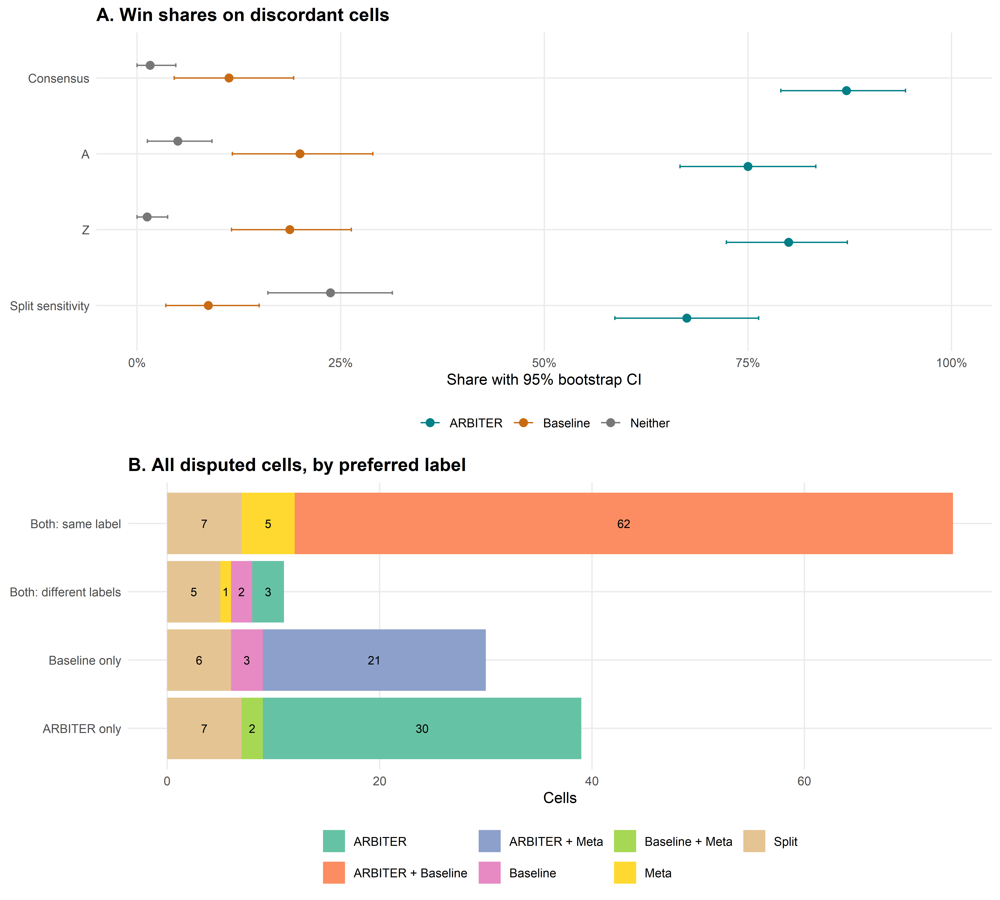

```{r}
#| label: rebuild
source('run.R')
source('R/report.R')
```

## Methods facts

[AUTHORS: model IDs, effort setting, run dates, ARBITER commit used for runs]

The run READMEs and harness metadata identify models `claude-sonnet-5-5` and `claude-haiku-5-5`, effort medium, and Claude Code 2.1.278 with isolated configuration homes. ARBITER 1.0.0 ([public commit 2f549ae](https://github.com/AliSalman-et-al/ARBITER/commit/2f549ae30f056ff441ea61a04b719968716f2219)) was used for the runs, as specified by the author amendment. ARBITER-Sonnet ran on 12 October 2026 (12:12–19:17 EDT); the other arms ran on 14 October 2026, per their READMEs. The placeholder above is retained for author confirmation of these now-documented facts. Each arm ran each trial once. Run-to-run variability is not estimated.

The ARBITER prompt invokes `/arbiter-assess`. The baseline uses the same minimal assessment request without the skill, followed by a fixed output-format instruction; the two prompts are not identical. Both templates and the verbatim baseline format instruction are quoted in the supplement. The ARBITER harness approved the proposed result unchanged and resumed with “Approved.” The protocol permitted uncoached “Continue.” replies at most twice per phase; observed counts are reported in the supplement. Baseline access was limited to Read, Glob and Grep, with no MCP server, skills or web tools; the supplied registry Markdown and acquired protocol/SAP documents preserved input parity.

The analysis includes 102 trials, after excluding atwine-2020, haney-2004 and herrmann-2016 for unsupported designs. Only the win share on consensus discordant cells is confirmatory. All other estimates are secondary or exploratory. Intervals use 10,000 percentile bootstrap replicates, resampling trials within each meta-analysis, seed `r SEED`. All estimates and paired contrasts use the same replicate weights. Blank CSV estimates and em dashes indicate undefined values. Metrics and differences are expressed on the 0–1 scale, except that agreement coefficients and differences can be negative. No p-values or multiplicity adjustment are used.

Missing arm judgements count as wrong. Ordinal coefficients for missing Haiku judgements use the documented maximal-disagreement penalty; an observed-cell sensitivity is supplied. The composite reference uses consensus preferred judgements on consensus disputed cells and meta labels on other cells, excluding split cells.

Adjudicators could only choose among the three labels offered. Cells where both Sonnet arms matched the meta label were never adjudicated and are assumed correct. Both features inflate absolute composite values for the Sonnet arms. Composite accuracy must not be presented as an accuracy claim in the abstract.

## Figure 1: architecture and draft trace



The draft trace uses a consensus cell where ARBITER-Sonnet matched the preferred judgement and differed from the meta label. Five candidates and their full active-question justifications are in [worked-trace-candidates.csv](output/tables/worked-trace-candidates.csv). Authors select the final trace; the diagram records a provisional selection.

## Figure 2: study flow



The analysis contains `r nrow(inputs$trials)` trials from `r n_distinct(inputs$trials$meta_id)` meta-analyses, `r nrow(cells)` disputed cells, `r sum(cells$consensus)` consensus cells and `r sum(!cells$consensus)` split cells.

## Table 1: benchmark set

Domain distributions are Low / Some concerns / High counts.

```{r}
show_table(table_data('table1'))
```

## Figure 3: adjudication endpoint



```{r}
p <- table_data('primary-endpoint')
cons <- p |> filter(analysis=='Consensus')
```

On `r cons$n[1]` consensus discordant cells, ARBITER-Sonnet won `r cons$count[cons$metric=='ARBITER']`, baseline-Sonnet won `r cons$count[cons$metric=='Baseline']`, and neither won `r cons$count[cons$metric=='Neither']`. ARBITER win share was `r estimate_ci(filter(cons,metric=='ARBITER'))` (95% CI).

```{r}
show_table(p |> select(analysis,metric,n,count,estimate,lower,upper))
```

Panel B counts preferred labels by equality, including labels shared by multiple sources. Split-cell sensitivity forces split discordant cells to be ARBITER losses; its residual category includes these forced losses.

## Table 2: agreement with meta labels

Cells are pooled D1–D5 (`r 102*5` per arm) or Overall (`r sum(!is.na(filter(inputs$labels,arm=='ARBITER-Sonnet',domain=='Overall')$meta))` per arm). Values are estimates (95% CI). Sensitivity and specificity classify Not Low using meta labels as the reference. All-Low reports accuracy and specificity only.

```{r}
show_metrics('table2')
show_metrics('table2-differences',c('comparison','domain'))
```

Pooled D1–D5 exact agreement with meta labels was `r headline('agreement-meta','accuracy','ARBITER-Sonnet','D1-D5')` for ARBITER-Sonnet and `r headline('agreement-meta','accuracy','Baseline-Sonnet','D1-D5')` for baseline-Sonnet. The latter reproduces 395/510.

## Figure 4: domain agreement and composite reference


The composite includes 485 cells per Sonnet arm. Pooled weighted κ was `r headline('agreement-composite','kappa','ARBITER-Sonnet','D1-D5')` for ARBITER-Sonnet and `r headline('agreement-composite','kappa','Baseline-Sonnet','D1-D5')` for baseline-Sonnet.

```{r}
show_table(metric_table(table_data('agreement-composite') |>
  filter(domain=='D1-D5',arm!='All-Low',metric %in% c('kappa','AC2','accuracy'))))
show_table(metric_table(table_data('agreement-composite-differences') |>
  filter(domain=='D1-D5',metric %in% c('kappa','AC2','accuracy')),c('comparison','domain')))
```

## Table 3: algorithm consistency

Domain algorithms use effect of assignment for D2. Overall classifications distinguish exact consistency, permitted escalation, and violations. Missing labels or required answers are not evaluable and are excluded from consistency-rate denominators.

```{r}
show_table(table_data('table3') |> filter(domain %in% c('D1-D5','Overall')) |>
  select(arm,domain,status,n,count,missing,estimate,lower,upper))
```

The proposed judgement agrees with the official domain algorithm in 510/510 ARBITER-Sonnet domains and 505/505 observed ARBITER-Haiku domains. The recorded override rates are 0/510 and 1/505 (0.20%), respectively. The hill-2017 D1 bundle records a Low to Some concerns override with rationale and evidence. Its adopted-label agreement with the algorithm is therefore 504/505 (99.80%). Five award-1-2014 domain labels remain missing. The amended gate passes. Judgements are algorithm-proposed; any model departure is recorded and auditable. Baseline violations are unrecorded departures.

## Process and audit metrics

```{r}
show_table(table_data('process-summary') |> filter(grepl('Sonnet',arm)))
show_table(table_data('process-differences'))
show_table(table_data('audit-summary') |> filter(grepl('Sonnet',arm)))
```

Time is the sum of harness-recorded turn seconds. Tokens, agent steps and costs are summed across turns; costs are harness-reported and their basis is unknown. Each arm has 102 analysis-set trials. Per-arm medians, quartiles and totals, paired mean-per-trial and total Sonnet differences, evidence-basis distributions and verification outcomes are provided in the supplement. The baseline has no evidence trace, so its audit metrics are not available.

## Table 4: reliability of the reference standard

```{r}
show_table(metric_table(table_data('table4-reliability'),c('comparison','n')))
show_table(table_data('meta-consensus-confusion') |>
  pivot_wider(names_from=preferred,values_from=n))
show_table(table_data('meta-leniency') |> select(direction,n,count,estimate,lower,upper))
```

```{r}
rel <- table_data('table4-reliability')
len <- table_data('meta-leniency')
```

Adjudicator A–Z weighted κ was `r estimate_ci(filter(rel,comparison=='A vs Z independent',metric=='kappa'))` on independent judgements and `r estimate_ci(filter(rel,comparison=='A vs Z preferred',metric=='kappa'))` on preferred judgements. Among consensus disputed cells, meta labels were less severe in `r len$count[len$direction=='Less severe']`/`r len$n[1]` cells (`r percent(len$estimate[len$direction=='Less severe'])`).

```{r}
#| results: asis
if(file.exists('output/tables/coding-counts.csv')) {
  print(show_table(table_data('coding-reliability')))
  print(show_table(table_data('coding-counts')))
} else cat('**Human error-taxonomy coding pending.** An empty coding sheet and draft codebook are supplied. No row-level codes have been assigned by an LLM.\n')
```

## Descriptive grounding metric

```{r}
g <- table_data('grounding') |> filter(grepl('Sonnet',arm))
show_table(g |> select(arm,n,quoted,estimate,lower,upper))
```

A quotation of at least five words appeared in `r g$quoted[g$arm=='ARBITER-Sonnet']`/`r g$n[g$arm=='ARBITER-Sonnet']` active ARBITER-Sonnet justifications (`r percent(g$estimate[g$arm=='ARBITER-Sonnet'])`) and `r g$quoted[g$arm=='Baseline-Sonnet']`/`r g$n[g$arm=='Baseline-Sonnet']` baseline-Sonnet justifications (`r percent(g$estimate[g$arm=='Baseline-Sonnet'])`). This is descriptive quotation syntax, not a measure of whether quotations were verified.

## Limitations facts and author completion

Adjudicators could only choose among the three offered labels. Unadjudicated cells where both Sonnet arms matched the meta label are assumed correct in the composite. These features inflate absolute composite values. Each arm assessed each trial once; run-to-run variability is not estimated. The final worked-trace selection, human taxonomy coding and checklist page/section references require author completion. Process times and costs are harness measurements; thinking tokens are reported separately and are part of output tokens. Trial PDFs are not redistributed; source DOIs and FILES.csv hashes identify them. [AUTHORS: public code/data repository and Zenodo DOI].
