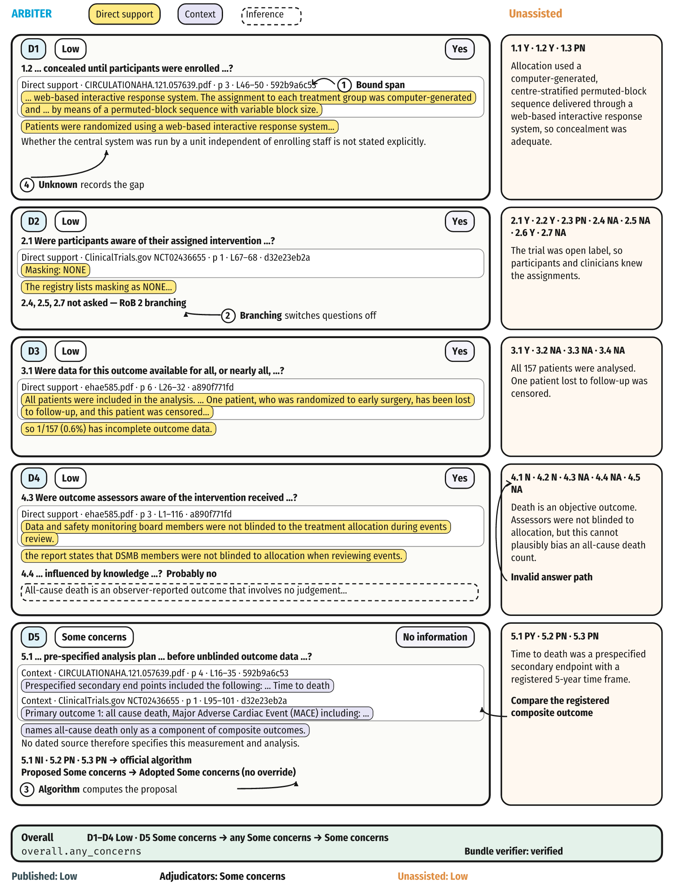
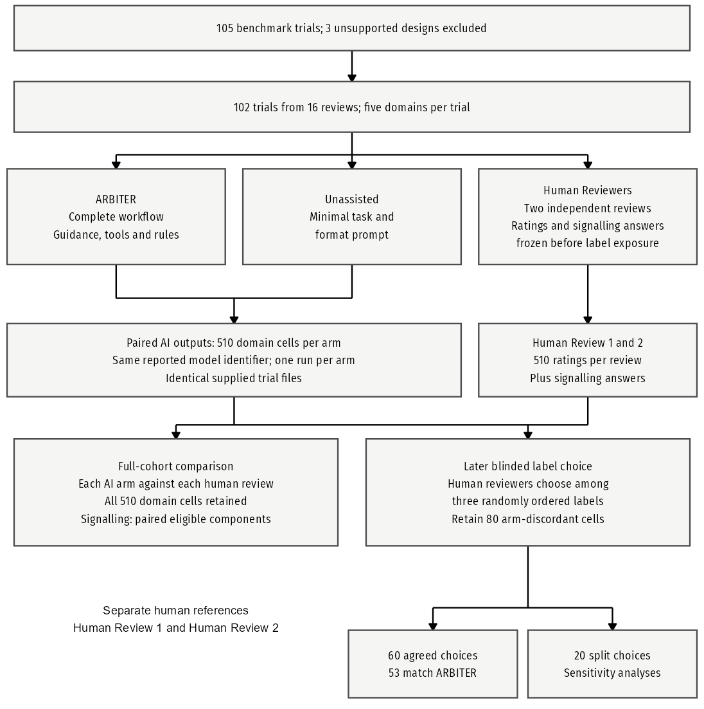
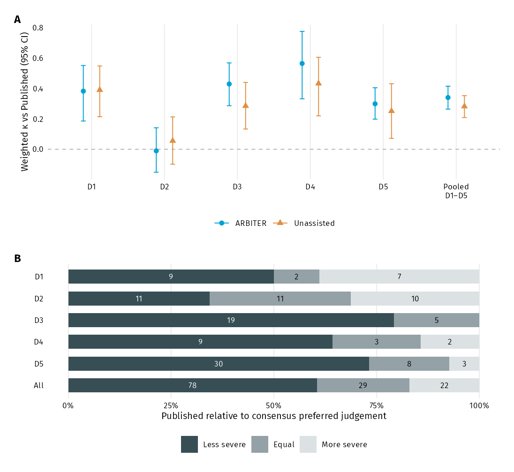
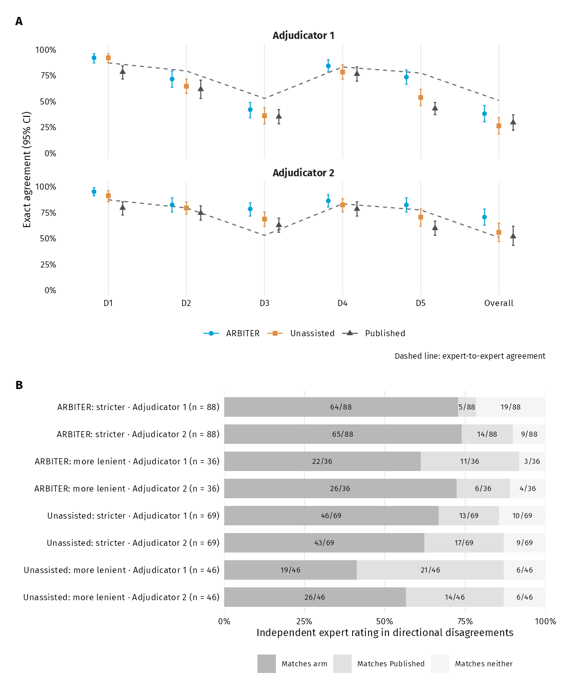

```{r}
source('run.R')
source('R/report.R')
main_tables <- list(benchmark_table(inputs),main_table2(),main_table3(),main_table4())
notes <- main_table_notes()
```

## Methods

The benchmark includes 102 trials from 16 meta-analyses. Models were Claude Sonnet 5.5 and Haiku 5.5, effort medium, using Claude Code 2.1.278 and isolated configuration homes. ARBITER 1.0.0 (public commit 2f549ae) was used. Sonnet with ARBITER ran on 12 October 2026; other arms ran on 14 October 2026. Each arm ran each trial once; run-to-run variability is not estimated. Prompts differ by the skill invocation and the Unassisted output-format instruction; templates and a filled example are in the supplement. Proposed results were approved unchanged. Up to two uncoached Continue replies per phase were permitted.

Only consensus-discordant win share is confirmatory. Intervals use 10,000 percentile bootstrap replicates, resampling trials within meta-analysis, seed 20261018. Missing judgements count as wrong. No p-values or multiplicity corrections are used. The composite excludes split cells and substitutes consensus preferred judgements on consensus cells. Adjudicators could only choose among the three offered labels. Cells where both Sonnet arms matched Published were never adjudicated and are assumed correct. Both features inflate absolute composite values; composite accuracy must not be an accuracy claim in the abstract.

## Figure 1: architecture and draft trace


The trace uses a consensus cell where ARBITER-Sonnet matched the preferred judgement and differed from the meta label. Four more-severe candidates where only ARBITER departed from meta, plus levin-2016 D2, with cited bundle passages, evidence identifiers, source/page locators, verification status and abbreviated answer sets are in [worked-trace-candidates.csv](output/tables/worked-trace-candidates.csv). The default is award-10-2018 D2. The trace shows the span binding to its hash-identified captured source and the recorded independent bundle verifier result. The displayed selection is provisional for author review.


## Figure 2. Study flow



## Table 1. Benchmark set

```{r}
main_ft <- house_table(main_tables[[1]],notes[[1]])
main_ft <- flextable::width(main_ft,j=1:6,width=c(.95,1.15,2.2,.45,1.2,.9))
main_ft
```

## Figure 3. Blinded adjudication



```{r}
p <- manuscript_data('primary-endpoint') |> filter(analysis=='Consensus')
```

Among 62 consensus cells where the arms differed, ARBITER won 54, Unassisted won 7, and neither won 1. ARBITER's win share was `r fmt_fraction(p$count[p$metric=='ARBITER'],62)` `r fmt_ci(p$lower[p$metric=='ARBITER'],p$upper[p$metric=='ARBITER'])` (95% CI).

## Table 2. Agreement (95% CI)

Blocks are: Published reference; composite reference; paired ARBITER − Unassisted differences.

```{r}
house_table(main_tables[[2]],notes[[2]])
```

## Figure 4. Published-label agreement and direction of error



## Table 3. RoB 2 rule consistency and audit (95% CI)

```{r}
house_table(main_tables[[3]],notes[[3]])
```

ARBITER proposals reproduce all 510 Sonnet and 505 observed Haiku domain judgements from the official algorithms. Sonnet has no recorded override. Haiku has one recorded override (hill-2017 D1, Low to Some concerns); its rationale is in the supplement. Evidence binding and bundle verification are structural checks and do not establish clinical correctness.

## Table 4. Reliability of the reference standard (95% CI)

```{r}
house_table(main_tables[[4]],notes[[4]])
```

## Figure 5. Decisive signalling questions



The primary localisation population contains 10 ARBITER and 47 Unassisted losses. Cells may contribute several decisive questions. Jointly decisive sets do not contribute individual-question counts. Class counts and the sensitivity population are supplementary.

## Time and reconstructed cost

```{r}
proc <- manuscript_data('table5')
```

Time per trial was `r proc[[2]][1]` minutes for ARBITER and `r proc[[3]][1]` minutes for Unassisted (median [IQR]); the paired mean difference was `r proc[[4]][1]` minutes (95% CI). Reconstructed API list-price cost per trial was US$`r proc[[2]][2]` and US$`r proc[[3]][2]`, respectively; the paired mean difference was US$`r proc[[4]][2]` (95% CI). These are list-price equivalents, not expenditure. The supplement gives process metrics, cost bounds and Haiku analyses.

## Supplementary material

[Supplement.docx](output/manuscript/Supplement.docx) contains numbered eTables and eFigures and the methods appendix. [TRIPOD-LLM.docx](output/manuscript/TRIPOD-LLM.docx) contains a checklist skeleton with GRRAS items, for author completion. Legends and alt text are in [figure-legends.md](output/manuscript/figure-legends.md).