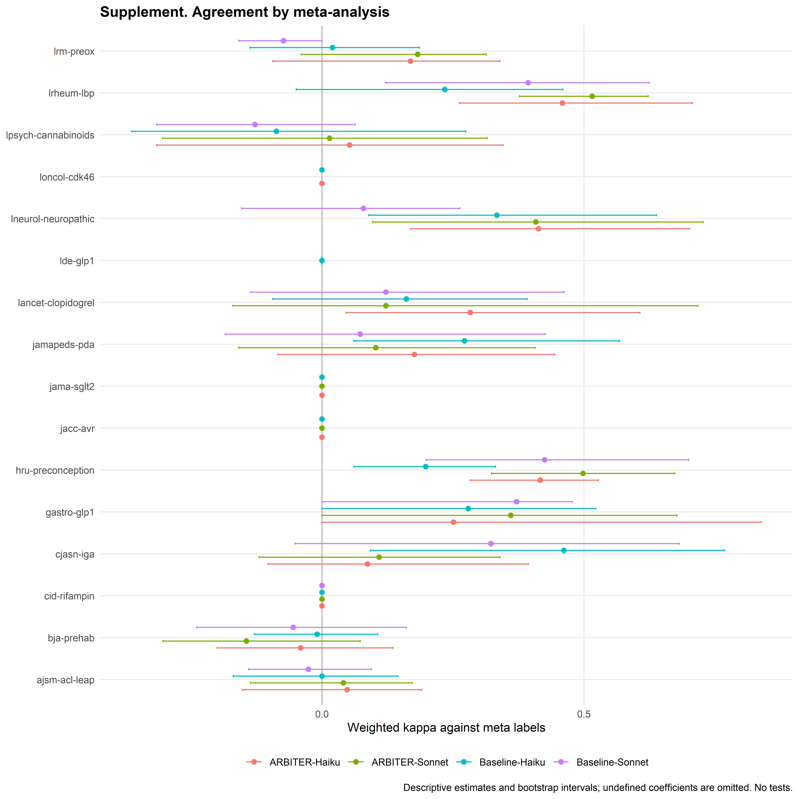

```{r}
source('R/load.R')
source('R/report.R')
source('R/checklist.R')
# Project order rebuilds results first; standalone supplement also rebuilds.
if(!file.exists('output/tables/table2.csv')) source('run.R')
```

## Full agreement with meta labels, including Haiku

Estimates (95% CI) use 10,000 stratified trial-cluster bootstrap replicates, seed 20261018. Sensitivity and specificity classify Not Low. All-Low has no variance; it reports accuracy and specificity only. Missing predictions count as wrong; the ordinal penalty and exclusion sensitivity are documented in DEVIATIONS.md. Valid-replicate counts are included in the CSVs.

```{r}
show_metrics('agreement-meta')
show_metrics('agreement-meta-differences',c('comparison','domain'))
```

## Composite reference, domain results and paired differences

Adjudicators could only choose among three offered labels. Cells where both Sonnet arms matched the meta label were never adjudicated and are assumed correct. Both features inflate absolute Sonnet composite values. Split cells are excluded from the consensus composite (485 cells per arm). No Haiku composite is calculated.

```{r}
show_table(metric_table(table_data('agreement-composite') |>
  filter(metric %in% c('kappa','AC2','accuracy'))))
show_table(metric_table(table_data('agreement-composite-differences') |>
  filter(metric %in% c('kappa','AC2','accuracy')),c('comparison','domain')))
```

## Per-adjudicator and split-cell sensitivity

```{r}
show_table(table_data('primary-endpoint') |> select(analysis,metric,n,count,estimate,lower,upper,valid_replicates))
show_metrics('composite-A')
show_metrics('composite-A-differences',c('comparison','domain'))
show_metrics('composite-Z')
show_metrics('composite-Z-differences',c('comparison','domain'))
```

Each adjudicator's composite replaces meta labels on every disputed cell with that adjudicator's preferred judgement (510 cells per arm). Split discordant cells count as ARBITER losses in the primary-endpoint sensitivity, with no fabricated baseline win. The residual category includes the forced losses.

## Missing-judgement sensitivity

The unfinished award-1-2014 ARBITER-Haiku run supplies no labels or answers. Its five domain cells count as wrong in the primary scoring. This sensitivity removes the same missing trial-domain pairs from both Haiku arms; it also removes its missing Overall judgement when a meta Overall label is available.

```{r}
show_metrics('missing-sensitivity')
show_metrics('missing-sensitivity-differences',c('comparison','domain'))
```

## Full confusion matrices

Rows are meta labels, columns are predictions. The complete 3×3 matrices include zero cells. Missing predictions are shown in a separate column rather than represented as a recovered ordinal label.

```{r}
show_table(table_data('confusion-matrices') |>
  pivot_wider(names_from=predicted,values_from=n))
```

## Forest plot by meta-analysis



```{r}
show_table(table_data('forest-meta') |> select(meta_id,arm,n,estimate,lower,upper,valid_replicates))
```

The plot is descriptive, with no statistical tests. Undefined κ estimates (zero chance-correction denominator) retain empty intervals and valid-replicate counts in the table. Constant predictions can yield κ = 0 when that denominator is nonzero.

## Table 3 supplement: algorithm consistency

```{r}
show_table(table_data('table3-supplement') |> select(arm,domain,status,n,count,missing,estimate,lower,upper))
show_table(table_data('algorithm-mismatches') |> select(arm,slug,domain,label,algorithm,status))
show_table(table_data('recorded-overrides') |> select(arm,slug,domain,proposed,adopted,rationale,evidence))
show_table(table_data('question-map'))
```

**ARBITER-Haiku consistency footnote:** all 505 observed proposed domain judgements agree with the official algorithm (100%); one recorded override (1/505, 0.20%) gives adopted-label agreement of 504/505 (99.80%). Five additional domain labels are not evaluable. The hill-2017 D1 bundle records 1.1=NI, 1.2=PY, 1.3=N, a Low proposal and adoption of Some concerns, with the rationale and evidence listed above. This is a recorded model override, not an algorithm violation or export error. ARBITER-Sonnet has 510/510 proposed agreement and no overrides. The gate checks proposals against the official algorithm and adopted labels against the exported labels. Missing labels and missing required answers are excluded from consistency denominators. Permitted Overall escalations are not violations.

Algorithms were transcribed from [RoB 2 full guidance, 22 August 2019](https://www.cochrane.de/sites/cochrane.de/files/uploads/RoB_2.0_guidance_2019.pdf), tables 4, 6, 10, 12 and 14, and cross-checked against [ARBITER 1.0.0, source commit 2f549ae](https://github.com/AliSalman-et-al/ARBITER/tree/2f549ae30f056ff441ea61a04b719968716f2219), identified as the run version by the author amendment.

## Process and audit metrics (section 5.8)

Reports read the committed per-arm CSVs in data-derived/. The separate extractor streams raw JSONL, cross-checks terminal usage against metadata, and reads bundle decisions and verification results. It stops if logs are absent. It is not run during rendering.

```{r}
show_table(table_data('process-summary'))
show_table(table_data('process-differences'))
show_table(table_data('audit-summary'))
show_table(table_data('evidence-bases-distribution'))
```

Per-arm summaries are median, first/third quartiles, and total over 102 trials. Paired contrasts are the mean per-trial ARBITER-Sonnet minus baseline-Sonnet difference and the total difference, with the same 10,000 bootstrap weights as the primary endpoint. Costs are harness-reported USD with unknown cost basis. Thinking tokens are a component of output tokens and are not added to output again. Evidence coverage denominators are active answers in available bundles. Verification denominators are available bundles, including any bundle with no assessed domains; absent bundles are not silently treated as passes. Baseline evidence traces are not available, rather than zero.

## Reference reliability and meta-label direction

```{r}
show_table(metric_table(table_data('table4-reliability'),c('comparison','n')))
show_table(table_data('meta-leniency') |> select(direction,n,count,estimate,lower,upper))
show_table(table_data('meta-consensus-confusion') |> pivot_wider(names_from=preferred,values_from=n))
```

## Grounding, all arms

```{r}
show_table(table_data('grounding') |> select(arm,n,quoted,estimate,lower,upper))
```

Only active signalling answers count. The detector requires paired straight or curly double quotes around at least five whitespace-separated words. It detects quotation syntax and does not verify quotations against trial documents.

## Exploratory signalling-answer agreement

Independent adjudicator answers define the questions evaluated, restricted to disputed domains. Answers collapse to Y/PY, N/PN, and NI/NA. Missing arm answers count as wrong. Haiku is included in this comparison with independent answers; it has no preferred-judgement endpoint, composite or taxonomy analysis.

```{r}
show_table(table_data('signalling-agreement') |>
  select(arm,adjudicator,question,n,correct,estimate,lower,upper))
```

## Human error-taxonomy coding

```{r}
#| results: asis
if(file.exists('output/tables/coding-counts.csv')) {
  print(show_table(table_data('coding-reliability')))
  print(show_table(table_data('coding-counts')))
} else cat('**Human coding pending.** No row-level error codes have been assigned by an LLM.\n')
```

The [draft codebook](output/coding/codebook-draft.csv), [instructions](output/coding/README.md), [empty sheet](output/coding/coding-sheet-empty.csv) and [working sheet](output/coding/coding-sheet.csv) are supplied. Every row is a losing source on a consensus cell and includes both adjudicators' explanations. Author 1 codes every row. Author 2 independently codes the fixed random 20% sample, rounded upward, seed 20261019. The pipeline preserves the working sheet, validates fixed row content, and reports unweighted Cohen κ when required codes are complete. A partial sheet retains this placeholder.

```{r}
show_table(readr::read_csv('output/coding/codebook-draft.csv',show_col_types=FALSE))
```

## Prompt template and one filled example

The template uses LABEL-TARGETS.csv columns assess_outcome, assess_values_as_printed, and slug, respectively. The example is the first analysis-set slug in alphabetical order.

```{r}
#| results: asis
p <- table_data('prompt-template-example')
for(i in seq_len(nrow(p))) cat('\n**',p$type[i],'**\n\n',p$prompt[i],'\n',sep='')
```

## Worked-trace candidates

Five cells are exported with the full ARBITER justifications verbatim. The two eligible cells with an explicit five-word double quotation are prioritised. Other candidate justifications are retained without fabricating source quotations.

```{r}
show_table(table_data('worked-trace-candidates') |>
  select(slug,domain,meta,ARBITER_label,Baseline_label,preferred,has_qualifying_quotation))
```

## TRIPOD-LLM and GRRAS checklist skeleton

These abbreviated topic labels map to official item IDs. Authors must assess applicability and complete blank page/section columns against the full [TRIPOD-LLM checklist](https://www.tripod-statement.org/wp-content/uploads/2025/01/TRIPOD-LLM-Checklist.pdf) and [GRRAS checklist](https://www.equator-network.org/wp-content/uploads/2012/12/GRRAS-checklist-for-reporting-of-studies-of-reliability-and-agreement.pdf). The skeleton is not a claim of reporting compliance.

```{r}
checklist <- reporting_checklist()
readr::write_csv(checklist,'output/tables/reporting-checklist-skeleton.csv')
show_table(checklist |> select(-source))
```

## Reproducibility and provenance

```{r}
show_table(table_data('reproducibility'))
```

[AUTHORS: model IDs, effort setting, run dates, ARBITER commit used for runs]. For author confirmation: `claude-sonnet-5-5` and `claude-haiku-5-5`, medium effort, Claude Code 2.1.278, isolated homes; ARBITER 1.0.0 (public commit 2f549ae). ARBITER-Sonnet ran on 12 October 2026 (12:12–19:17 EDT), and the other arms on 14 October 2026, per READMEs. The harness approved proposed results unchanged and resumed with “Approved.”; uncoached “Continue.” replies were permitted at most twice per phase. Each arm assessed each trial once; run-to-run variability is not estimated. [AUTHORS: repository and Zenodo DOI]. Trial PDFs are not redistributed; metadata provide DOIs and FILES.csv hashes.
