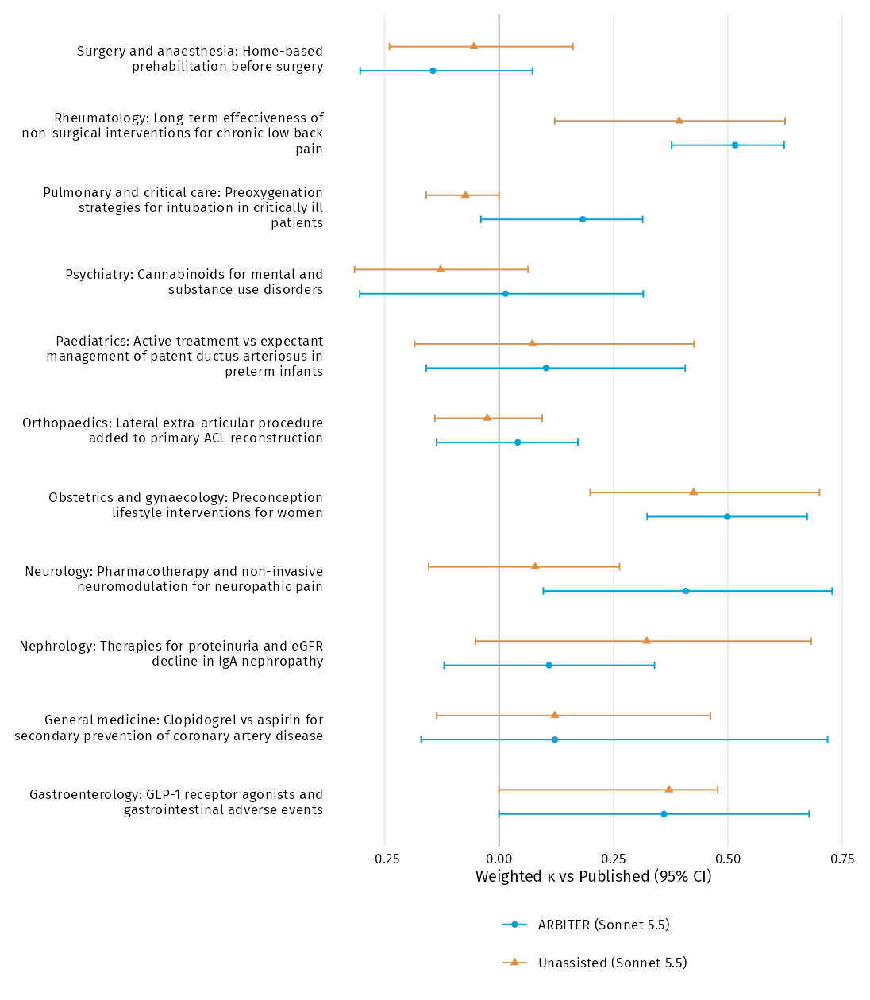

```{r}
source('R/load.R')
source('R/publication-io.R')
source('R/presentation.R')
source('R/manuscript-tables.R')
source('R/manuscript-supplement.R')
source('R/checklist.R')
source('R/avatar-trace.R')
if(!file.exists('output/manuscript/Supplement.docx')) source('run.R')
if(!exists('inputs')) inputs <- load_inputs()
entries <- supplement_registry(inputs)
METHODS_APPENDIX <- reader_label(METHODS_APPENDIX)
```

[Download Supplement.docx](output/manuscript/Supplement.docx). The Word document and this working view use the same display objects and numbering. [TRIPOD-LLM and GRRAS checklist](output/manuscript/TRIPOD-LLM.docx) is a separate reporting map, with author-completion needs flagged.

## Methods appendix

```{r}
for(i in seq_along(METHODS_APPENDIX)) cat('\n### ',names(METHODS_APPENDIX)[i],'\n\n',METHODS_APPENDIX[i],'\n',sep='')
```

## Supplementary results

```{r}
for(i in seq_along(entries)) {
  cat('\n### eTable ',i,'. ',entries[[i]]$caption,'\n\n',sep='')
  e <- entries[[i]]
  if(is.null(e$blocks)) cat(flextable::flextable_to_rmd(supplement_table(e)),sep='\n')
  else for(block in e$blocks) {
    cat('\n#### ',block$title,'\n\n',sep='')
    cat(flextable::flextable_to_rmd(supplement_table(e,block$data)),sep='\n')
  }
  if(entries[[i]]$caption=='Per-meta-analysis weighted κ') {
    cat('\n### eFigure 1. Agreement with Published varied across meta-analyses\n\n\n\n')
    cat(paste('Weighted kappa and 95% CIs; source symbols distinguish model and assistance.',
      'Undefined coefficients are omitted. Specialty and topic identify each meta-analysis. Descriptive estimates only; no statistical tests.',CI_NOTE),'\n\n')
  }
}
```

## Prompt templates and filled example

```{r}
prompts <- manuscript_data('prompt-template-example')
for(slug in inputs$trials$slug) prompts$prompt <- gsub(slug,trial_display(slug),prompts$prompt,fixed=TRUE)
for(i in seq_len(nrow(prompts))) cat('\n### ',reader_label(prompts$type[i],TRUE),'\n\n',prompts$prompt[i],'\n',sep='')
```

## Run provenance

Model: claude-sonnet-5-5; effort medium; Claude Code 2.1.278; isolated configuration homes. ARBITER 1.0.0, public commit 2f549ae30f056ff441ea61a04b719968716f2219. Sonnet with ARBITER ran 12 October 2026; other arms ran 14 October 2026. The proposed result was approved unchanged; up to two uncoached Continue replies per phase were permitted. Each arm ran each trial once. Trial PDFs are not redistributed; source DOIs and FILES.csv hashes identify them. See the Word supplement for the full provenance statement.
